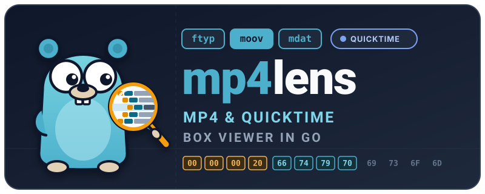

[](https://github.com/Eyevinn/mp4lens/actions/workflows/go.yml)
[](https://coveralls.io/github/Eyevinn/mp4lens?branch=main)
[](https://github.com/Eyevinn/mp4lens/actions/workflows/golangci-lint.yml)
[](https://pkg.go.dev/github.com/Eyevinn/mp4lens)
[](https://github.com/Eyevinn/mp4lens/blob/main/LICENSE)

Look inside MP4 and QuickTime files: the box tree with the position and size of every box, the fields and bytes
of each box, where in the bytes each field is, the structures inside boxes such as parameter sets, SEI messages
and descriptors, and the boxes that cannot be decoded, with the boxes around them still shown. What is specific
to QuickTime is marked. Search for box types, field values, file positions and bytes. A file summary gives the
overview that ffprobe and `MP4Box -info` give: brands, duration, metadata, chapters, and for each track its
codec string, samples and bitrate.

mp4lens comes as a web page and as a terminal viewer. Both decode with [mp4ff][mp4ff], and both show the same
things and take the same searches.

- **Web**: `make serve` builds the page and serves it at <http://localhost:8000/>. Open or drop a file. It is
  decoded in the browser by mp4ff compiled to WebAssembly; nothing is uploaded. Large files are read in slices,
  so they are not loaded into memory as a whole.
- **Terminal**: `mp4lens file.mp4`

## Install

```sh
go install github.com/Eyevinn/mp4lens/cmd/mp4lens@latest
```

## The terminal viewer

```sh
mp4lens file.mp4                   # browse the boxes
mp4lens -levels all:1 file.mp4     # with all fields, such as every sample of trun and stsz
mp4lens -search is:error file.mp4  # start at the boxes that cannot be decoded
mp4lens -find type:emsg file.m4s   # print the matching boxes and exit
mp4lens -summary file.m4a          # print the file summary and exit
```

The tree is on the left and the selected box on the right: its path, position, size, header, version and
flags, decode error, fields, byte layout and bytes, with the header and the child box headers marked in the bytes.
A file without errors opens with the file summary on the right, until you move in the tree.
Press `?` for the keys. The main ones:

| Key | Action |
|-----|--------|
| `↑` `↓` `←` `→` (or `k` `j` `h` `l`) | move, open and close boxes |
| `/` | search |
| `n` `N` | next and previous matching box |
| `f` | show only the matching boxes |
| `e` `E` | next and previous box that cannot be decoded |
| `a` | switch between the main fields and all fields |
| `m` | show more bytes and layout fields |
| `s` | show the file summary |
| `tab` | switch between the tree and the box pane |
| `q` | quit |

## Search

A box matches a query when it matches all its terms:

| Term | Matches |
|------|---------|
| `text` | text in the box type, its name or its fields, ignoring case |
| `type:trun,tfdt` | boxes of these types |
| `path:trak/mdia` | boxes whose path, such as `moov/trak/mdia/mdhd`, contains this |
| `key=value` | boxes with this field value, such as `trackID=2` or `handlerType=soun` |
| `@1234`, `@0x4d2` | the innermost box that holds the byte at this position |
| `size>1000` | boxes larger than 1000 bytes; also `<`, `<=`, `>=` and `=` |
| `hex:000001b6` | the innermost boxes that hold these bytes, which are marked in the bytes view |
| `is:error` | boxes that cannot be decoded |
| `is:unknown` | box types that mp4ff does not know |
| `is:truncated` | boxes that continue past the end of the file |
| `is:quicktime` | boxes, parts and fields that are specific to QuickTime |
| `is:part` | structures inside boxes, such as `SPS` or `ES_Descriptor` |

Put `-` before a term to match the boxes that do not match it, and quotes around text with spaces:
`"sample size" -type:stz2`.

## File summary

The summary has a section for the file, the movie, the metadata, the chapters and each track:

- **File**: size, brands, and how the boxes are arranged, such as moov before mdat, or an init segment and
  fragments
- **Movie**: duration, and the creation and modification times
- **Metadata**: the iTunes items in `ilst`, by name, such as Title and Track Number, with their values read, the
  freeform items by their name and domain, the QuickTime metadata by key, and the QuickTime user data texts
- **Chapters**: from a Nero `chpl` list, and from the text samples of chapter tracks
- **Tracks**: handler, flags, language, references, sample entries with their codec strings (RFC 6381, such as
  `avc1.64001F` or `mp4a.40.2`), video size and colour, audio format, encryption, duration, the number of
  samples and sync samples, the bitrate from the sample sizes, and the edit list. For a fragmented file, the
  samples are counted in the track fragments

On the web page, a file without errors opens with the summary, and the names of values that come from a box
select that box. The file name above the summary, the File summary button and the `s` key bring it back.
Images in the file are shown: the cover art in `covr` and the images of chapter image tracks in the summary, and
the image of a selected `data` box in the box pane. A box without child boxes whose payload has a JPEG or PNG
signature in its first 16 bytes, such as a thumbnail that a camera writes in `udta`, is shown as an image from
there to its end, in the box pane and in the Images section of the summary. A click opens an image on its own.

## Fields, layout and parts

Each box shows two views of its content:

- **Fields**: the `Info` output of the mp4ff box, the same as `mp4ff-info` prints, with values interpreted,
  such as times and fixed-point numbers
- **Layout**: the fields on the wire, as the mp4ff decoder reads them, with their file position, offset in the
  box, size, kind (such as `u32` or `bytes`), name and raw value. This is the format of the box, also where the
  mp4ff structs keep the data in another form, such as the cumulative sample numbers of `ctts`. On the web
  page, pointing at a layout row or a field marks its bytes, and pointing at a byte shows its field

Plain container boxes, whose child boxes start right after the header and fill the box, such as `moov` and
`trak`, are marked as containers and have no fields or layout of their own. Boxes with fields before or after
their children, such as `meta`, `stsd` and the sample entries, have both.

The names in the layout come from the source of the mp4ff decoders: a read gets the name of the field that it
sets, such as `TrackID` for `t.TrackID = sr.ReadUint32()`. `go generate ./internal/layout` makes the table of
names from the mp4ff version in `go.mod`, and CI checks that it is up to date. Repeated reads are numbered, as
`Matrix[2]` or `SampleSize #3`.

For the common ISOBMFF boxes and the QuickTime atoms that mp4ff decodes, syntax tables in `internal/layout`
give the fields their names in the specification, such as `entry_count` and `sample_size[3]`, say what each field
is, name the specification and clause, and split packed values: the version and flags of a full box with the
names of the flags, the sample flags of track fragments, the dependency bits of `sdtp`, the references of
`sidx`, and the language of `mdhd`. Fixed-point values and times are also shown in their meaning.

**Parts** are the structures that boxes hold as bytes, decoded with mp4ff and shown as children of the box:

| Box | Parts |
|-----|-------|
| `avcC` | SPS and PPS, with all their fields |
| `hvcC` | VPS, SPS, PPS and SEI NAL units, with the SEI messages |
| `vvcC` | NAL units with their headers |
| `av1C` | OBUs, with the sequence header |
| `esds` | `ES_Descriptor`, `DecoderConfigDescriptor`, `DecoderSpecificInfo` with the AudioSpecificConfig, and `SLConfigDescriptor` |

## QuickTime

The QuickTime File Format and ISOBMFF share most boxes, but QuickTime adds atoms and gives meaning to bytes
that ISOBMFF reserves. mp4lens marks them with `QT` and says what they are:

- files with the `qt` brand, or without `ftyp`
- QuickTime atoms, such as `wide`, `wave`, `chan`, `keys`, `fiel`, the terminator atom, and the text atoms in `udta`,
  such as `©nam`, whose texts and language codes are in the fields and the layout
- the QuickTime meta atom without version and flags, and the terminator at the end of `udta`
- fields that overlay reserved or pre_defined bytes of ISOBMFF, such as the vendor and quality of sample
  entries, the component type of `hdlr` and the times of `mvhd`, when they are not 0
- the fields of version 1 and 2 sound descriptions, which ISOBMFF does not have

## How it works

The [`boxtree`][boxtree] package of mp4ff decodes the box tree. It keeps the position of every box, and when a
box cannot be decoded, it decodes its children one by one, so the error is reported on the smallest box that
fails while the boxes around it are still decoded. The fields are the `Info` output of the mp4ff boxes, the
same as `mp4ff-info` prints.

This repository holds the viewers:

- `internal/boxview`: the tree for viewing (parents, keys, long box names, fields, parts, QuickTime notes),
  JSON for the web page, and the search
- `internal/layout`: the byte layout of a box, from a `bits.SliceReader` that records the reads of the mp4ff
  decoder, with the names from the decoder source in `names_gen.go`
- `internal/parts`: the structures inside boxes
- `internal/summary`: the file summary
- `internal/tui` and `cmd/mp4lens`: the terminal viewer, built with [Bubble Tea][bubbletea]
- `web`: the web page; `web/wasm` is the decoder for `GOOS=js GOARCH=wasm`, which runs in a Web Worker

## The web page on your computer

```sh
make serve            # or: go run ./web/build -serve localhost:8000
```

builds the page into `web/site` and serves it at <http://localhost:8000/> until stopped; `PORT=9000 make serve`
uses another port. The page needs a web server, since browsers do not run its Web Worker from `file:` URLs, but
`web/site` is plain static files, so any static web server can serve it. `make web` only builds it.

The Pages workflow builds the same site and publishes it on GitHub Pages. For now it runs only when started by
hand.

The site gets the favicon and the link preview image from `images`. `images/social-preview.png` is the logo on
its background color, at the 1280x640 that GitHub asks for, and is also the social preview of the repository
(uploaded in the GitHub settings). `make images/social-preview.png` makes it again after a change of the logo,
with rsvg-convert and ImageMagick.

## Development

```sh
make test                 # go test ./...
make check                # go.mod tidiness, go vet and golangci-lint
make pre-commit-install   # install the pre-commit and commit-msg hooks
make pre-commit           # the pre-commit hooks on all files
make codespell            # spell check with the settings in .codespellrc
make generate             # the field names of the layout, from the mp4ff version in go.mod
make coverage             # coverage.html and coverage.txt
make vulncheck            # known vulnerabilities that the code reaches, with govulncheck
make check-licenses       # the licenses of the dependencies, with wwhrd
make build                # out/mp4lens
```

The hooks run gofmt, golangci-lint, the unit tests and codespell before each commit, and commitlint checks that
commit messages follow [Conventional Commits](https://www.conventionalcommits.org/). They run from a Python
environment in `.venv`, which `make` creates.

## Status

mp4lens uses the `boxtree` package of mp4ff v0.62.0, and needs a later fix on the mp4ff master branch, so that
the layout shows the fields of QuickTime and 3GPP text atoms such as `chan`, `chpl` and `tx3g`. Until a release
has the fix, `go.mod` requires a master commit of mp4ff.

The example files in `testdata` come from the mp4ff test data, except the `qt_*.mov` files, which are made with
ffmpeg from its test sources, and `chapters_subs.m4a`, which ffmpeg makes from the audio of `qt_h264_aac.mov`
with two chapters, two subtitles, a title and track number, and a 64x64 cover image from its test pattern.

`MP4LENS_CORPUS=files.txt go test -count=1 ./internal/boxview -run TestCorpus -v` decodes the files listed in
`files.txt`, finds the layout of every box, and reports panics and how many layout bytes have names.

## Related tools

Other tools that show the boxes of MP4 files:

- [MP4Box.js][mp4boxjs] from GPAC has a [file inspection page][mp4boxjs-filereader] with the box tree and
  fields, views of where the bytes of the file go, and tables of the samples, items and segment index
- [MP4Inspector][mp4inspector] from Bitmovin is a Chrome DevTools extension that shows the boxes of the segments
  that a web page loads, and compares two segments box by box
- [ISO Viewer][isoviewer] is a desktop application built on the Java library [mp4parser][mp4parser]
- [fq][fq] decodes MP4 among many other binary formats, with jq queries, an interactive prompt and a hex view
  next to the decoded values

mp4lens decodes with mp4ff, so it shows the boxes as programs built on mp4ff see them, and its box tree can be
browsed in a terminal as well as in the browser.

## Contributing

See [CONTRIBUTING](CONTRIBUTING.md).

## License

This project is licensed under the MIT License, see [LICENSE](LICENSE).

The gopher in the logo and favicon is adapted from the Go gopher, created by
[Renée French](https://reneefrench.blogspot.com/) and licensed under
[CC BY 4.0](https://creativecommons.org/licenses/by/4.0/).

## Support

Join our [community on Slack](https://slack.osaas.io/) where you can post any questions regarding any of our open source projects. Eyevinn's consulting business can also offer you:

- Further development of this component
- Customization and integration of this component into your platform
- Support and maintenance agreement

Contact [sales@eyevinn.se](mailto:sales@eyevinn.se) if you are interested.

## About Eyevinn Technology

[Eyevinn Technology](https://www.eyevinntechnology.se) helps companies in the TV, media, and entertainment sectors optimize costs and boost profitability through enhanced media solutions.
We are independent in a way that we are not commercially tied to any platform or technology vendor. As our way to innovate and push the industry forward, we develop proof-of-concepts and tools. We share things we have learned and code as open-source.

With Eyevinn Open Source Cloud we enable you to build solutions and applications based on Open Web Services and avoid being locked in with a single web service vendor. Our open-source solutions offer full flexibility with a revenue share model that supports the creators.

Read our blogs and articles here:

- [Developer blogs](https://dev.to/video)
- [Medium](https://eyevinntechnology.medium.com)
- [OSC](https://www.osaas.io)
- [LinkedIn](https://www.linkedin.com/company/eyevinn/)

Want to know more about Eyevinn? Contact us at info@eyevinn.se!

[mp4ff]: https://github.com/Eyevinn/mp4ff
[boxtree]: https://github.com/Eyevinn/mp4ff/tree/master/boxtree
[bubbletea]: https://github.com/charmbracelet/bubbletea
[mp4boxjs]: https://github.com/gpac/mp4box.js
[mp4boxjs-filereader]: https://gpac.github.io/mp4box.js/test/filereader.html
[mp4inspector]: https://github.com/bitmovin/MP4Inspector
[isoviewer]: https://github.com/sannies/isoviewer
[mp4parser]: https://github.com/sannies/mp4parser
[fq]: https://github.com/wader/fq
